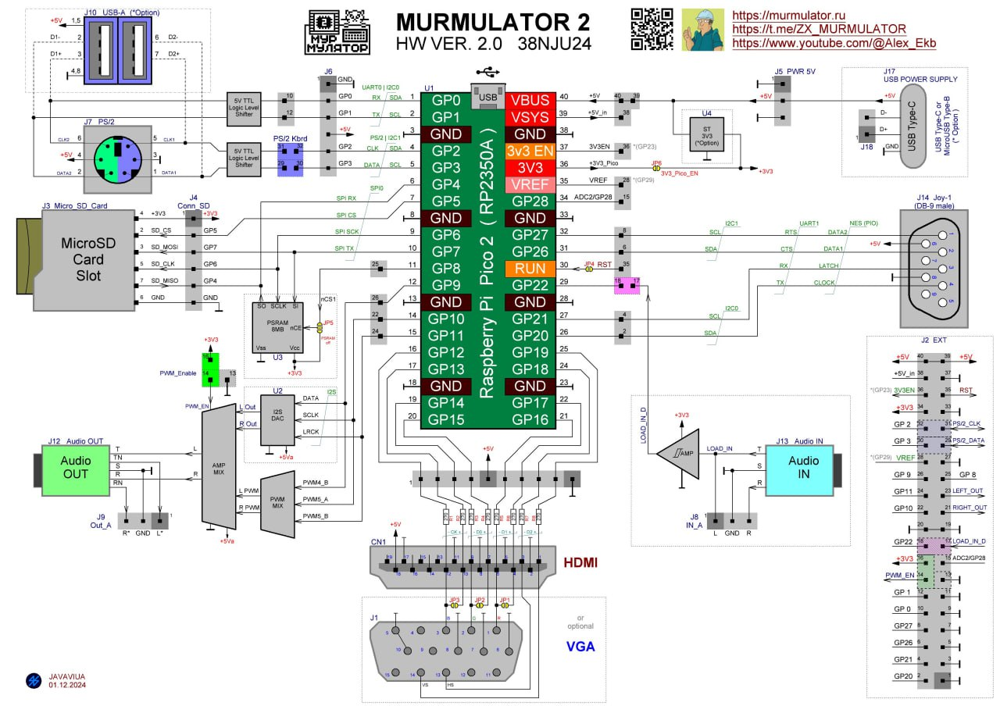

# Подготовка рабочего места: Murmulator 2.0

Статус: рабочая инструкция, редакция 0.1 (2026-10-14). Эталонное место собрано и проверено с pico-launcher, MOS2, murm386 и PICO-BK. Код платы в именах прошивок и в матрице совместимости — `m2p2` (Murmulator 2 + Raspberry Pi Pico 2, [`../COMPATIBILITY.md`](../COMPATIBILITY.md)).

> **Это не основная плата класса.** Основная — Olimex RP2040-PICO-PC + Pico 2 (README класса, п. 1.7.1). Murmulator 2.0 — открытый проект сообщества (README класса, п. 1.7.2): плату заказывают по гербер-файлам и собирают самостоятельно или покупают у независимых сборщиков. Серийного выходного контроля нет, поэтому качество пайки и компонентов у разных экземпляров различается — каждая плата перед установкой на место проверяется (раздел 2, п. 1). Зато у платы есть всё нужное классу без дополнительных модулей: свой звуковой выход с ЦАП, HDMI (или VGA), слот microSD, разъёмы PS/2 и геймпада, а модуль Pico 2 вставляется в разъёмы и меняется отдельно от платы, как у Olimex.

## 1. Плата

Murmulator 2.0 (плата **38NJU24**, HW 2.0, схема — ноябрь 2024) — плата проекта «Мурмулятор» под модуль Raspberry Pi Pico 2 (RP2350A). Автор — AlexEkb ([murmulator.ru](https://murmulator.ru/nextgen)); схема подключения — JAVAVIUA. С Мурмулятором 1.x плата **не совместима по выводам**: прошивки нужны собранные именно для M2 (префикс `m2p2-`). Отличия от M1 по замыслу автора: GP8 отдан под выбор микросхемы PSRAM (CS1), GP0 и GP1 свободны (COM-порт, мышь PS/2 или I2C), клавиатура PS/2 перенесена на GP2 и GP3, разъём геймпада — универсальный (2 × NES или 2 × Wii по I2C).

Назначение выводов Pico 2 (по схеме `assets/MURMULATOR2_HW20.pdf` и схеме подключения `img/m2p2-pinout.jpg`):

| Узел | Выводы | Примечание |
|---|---|---|
| HDMI / VGA | GP12–GP19 | восемь резисторов R1–R8 общие для обоих разъёмов: для HDMI — все по 270 Ом; для VGA — 1 кОм / 330 Ом / 100 Ом по схеме и замкнутые перемычки JP1–JP3. Разъём VGA (J1) — опция |
| microSD (SPI0) | SCK GP6, MOSI GP7, MISO GP4, CS GP5 | — |
| PSRAM (U3, ESP-PSRAM, 8 МБ) | SCLK GP6, SI GP7, SO GP4, CE GP8 | общая шина с SD-картой; перемычка JP5 отключает микросхему. Автор платы просит **не запаивать** её: это эксперимент для программистов |
| Клавиатура PS/2 (J7, mini-DIN) | CLK → GP2, DATA → GP3 | через преобразователь уровней 5 В → 3,3 В и **перемычки на J2: 31–32 (CLK) и 29–30 (DATA)** — без них клавиатура PS/2 не работает |
| Второе устройство PS/2 и верхний USB-A (J10) в режиме PS/2 | CLK → GP0, DATA → GP1 | контакты 6 и 2 разъёма J7 (разветвитель «клавиатура + мышь») и разъём USB-A; через перемычки на J6. Это **не** USB-хост: USB-клавиатура в режиме HID сюда не подключается |
| Геймпад (J14, DB-9 «папа») | CLOCK GP20, LATCH GP21, DATA1 GP26, DATA2 GP27 | два геймпада NES (Dendy) через разветвитель; те же выводы — I2C1/UART для геймпадов Wii |
| ЦАП I2S (U2, TDA1387) | DATA GP9, BCK GP10, LRCK GP11 | выход — на гнездо J12 (Audio OUT) через усилитель на транзисторах |
| Звук PWM | GP9, GP10, GP11 | тот же выход J12; выбор I2S или PWM — перемычкой PWM_EN (раздел 2.1) |
| Вход магнитофона (J13, Audio IN) | LOAD_IN_D → GP22 | через компаратор и перемычку J2 17–18; для загрузки с аудио (БК, ZX Spectrum) |
| Сброс | RUN (JP4) | кнопка RST; BOOTSEL — кнопка на самом модуле Pico 2 |

Питание 3,3 В — от стабилизатора модуля Pico 2 (перемычка JP6 3V3_Pico_EN) или от отдельного стабилизатора U4 на плате (опция). Питание 5 В — разъём J17 (USB Type-C или microUSB, только питание) или контакты J5 PWR 5V; разъём micro-USB модуля Pico 2 при этом свободен для клавиатуры.

К основной плате есть **поддон** — дополнительная плата **38EJU24** с HDMI, композитным видеовыходом, USB-хабом и вторым разъёмом геймпада. Для рабочего места класса он не нужен; микросхему XN297L на нём автор просит не запаивать (тоже эксперимент).

## 2. Комплектация одного рабочего места

| Компонент | Количество | Примечание |
|---|---:|---|
| Плата Murmulator 2.0 (38NJU24) | 1 | Собранная и проверенная. **Рекомендуемый вариант сборки для класса: HDMI (R1–R8 по 270 Ом), без PSRAM на плате (U3 не запаивать), без поддона.** VGA вместо HDMI — по выбору: проверяются оба варианта |
| Raspberry Pi Pico 2 | 1 | или электрически совместимый модуль на RP2350 в форм-факторе Pico с припаянными штыревыми контактами. Для прошивок из `/emu/psram` нужен модуль с PSRAM **на самом модуле** (например, Pimoroni Pico Plus 2) — PSRAM на плате для них не используется |
| Монитор HDMI и кабель HDMI → HDMI | 1 | Обязательна поддержка режима 640×480 при 60 Гц; для эмулятора БК (PICO-BK) по умолчанию нужен режим 720×576 при 50 Гц (CEA 576p), при отборе модулей Pico 2 (раздел 6.3) — также 800×600 при 60 Гц. Однорежимные кассовые мониторы, не поддерживающие 640×480 при 60 Гц, не подходят. Для сборки с VGA — монитор VGA |
| USB-клавиатура HID, 101+ клавиша | 1 | Полноразмерная, с NumPad. Подключается к разъёму micro-USB модуля Pico 2 через OTG-переходник USB-A (гнездо) → micro-USB (штекер); подбор переходника требует проверки с конкретным экземпляром. Клавиатура PS/2 — вариант для прошивок без `HID` в имени (раздел 2.1) |
| microSD-карта | 1 | Форматирование FAT32 с размером кластера 4 КБ (раздел 4); требуется проверка совместимости с протоколом SPI (чаще всего это карты объёмом до 32 ГБ) |
| Наушники | 1 | Подключаются к гнезду Audio OUT (J12); на местах преподавателя и демонстрации — активные колонки |
| Питание | комплект | Блок питания 5 В с кабелем к разъёму J17 платы (USB Type-C или microUSB, в зависимости от сборки). Блок питания желательно проверить заранее, чтобы избежать проблем с уровнем пульсаций |
| Подложка под плату | 1 | Коврик для мыши или кусок мягкого материала: плата без корпуса, подложка защищает её контакты и стол (README класса, п. 1.7.8) |

Клавиатура PS/2, мышь, геймпады NES, PSRAM и поддон — опции, не необходимые для базового рабочего места.

## 3. Аппаратная подготовка

1. Осмотреть плату: пайку разъёмов HDMI, microSD, PS/2, DB-9, гнезда Audio OUT и гребёнок под модуль, отсутствие перемычек припоем и механических повреждений. Плата самодельная или собрана сторонним сборщиком, поэтому осмотр обязателен для каждого экземпляра. Модуль Pico 2 перед установкой на место учащегося проходит отбор по разделу 6.3.
2. Выставить перемычки по разделу 3.1.
3. Положить плату на мягкую подложку (коврик для мыши): корпуса нет, а при нажатии кнопок выводы обратной стороны не должны вдавливаться в стол (README класса, п. 1.7.8).
4. При отключённом питании установить Pico 2 в разъёмы платы, соблюдая ориентацию по контуру модуля на шелкографии платы (вывод 1 — GP0). Не пытаться вставлять модуль с несовместимыми контактами.
5. Подключить монитор. **Убавить громкость встроенных динамиков монитора до нуля** (см. примечание о звуке через HDMI ниже).
6. Подключить наушники к гнезду Audio OUT (J12). Для преподавательского и демонстрационного места — активные колонки.
7. Подготовить microSD по разделу 4 и установить её в слот платы.
8. Установить менеджер прошивок по разделу 5.
9. Подключить USB-клавиатуру к разъёму micro-USB модуля Pico 2 через OTG-переходник.
10. Подключить блок питания 5 В к разъёму J17. Первое включение — после завершения всех соединений.

**Звук через HDMI.** MOS2 выводит звук только в гнездо платы, но некоторые прошивки (PICO-BK) передают звук и по HDMI. Если на мониторах оставлена громкость, запуск такой прошивки на нескольких местах сразу даст какофонию на весь класс. Поэтому громкость динамиков мониторов выставляется в ноль при подготовке места и проверяется перед занятием; звук у учащегося — только в наушниках. Выводит ли прошивка звук в HDMI, указано в [`../COMPATIBILITY.md`](../COMPATIBILITY.md).

### 3.1. Перемычки

| Перемычка | Положение для класса | Зачем |
|---|---|---|
| PWM_Enable (J2, контакт 14 — PWM_EN, рядом +3V3 на контакте 16 и GND на контакте 13; на схеме подключения выделена зелёным) | по описанию автора платы (левая перемычка): **вертикально — звук I2S (ЦАП TDA1387)**, горизонтально — звук PWM | выбирает источник звука для гнезда Audio OUT. Положение должно совпадать с прошивкой: у PICO-BK есть сборки `…-I2S-…` и `…-PWM-…`, murm386 выбирает выход в меню Win+F11 |
| J2 31–32 и 29–30 (PS/2 Kbd, выделены синим) | замкнуть, если используется клавиатура PS/2 | соединяют разъём PS/2 с GP2 (CLK) и GP3 (DATA) |
| J6 10 и 12 | по необходимости | второе устройство PS/2 или USB-A в режиме PS/2 на GP0/GP1; если эти выводы нужны прошивке для другого (COM-порт, I2C), перемычки снять |
| J2 17–18 (LOAD_IN_D, выделена розовым) | по необходимости | вход магнитофона на GP22 |
| JP1–JP3 | замкнуть только в сборке с VGA | подключают красный, зелёный и синий каналы разъёма VGA |
| JP5 (PSRAM off) | как в сборке | отключает PSRAM на плате; в рекомендуемой сборке микросхемы нет |

Номиналы в звуковом тракте, которые автор платы рекомендует для лучшего звука и которые уже указаны в схеме: R28, R40 — 620 Ом; R29, R38 — 10 кОм; R30, R37 — 200 кОм; R34, R42 — 2 кОм; R31, R36 — 1 кОм с конденсатором 1 нФ, припаянным поверх.

## 4. Подготовка SD-карты

1. Сохранить нужные данные с карты: форматирование удалит существующее содержимое.
2. Создать раздел с файловой системой **FAT32 с размером кластера 4 КБ** (4096 байт). С другим размером кластера возможны проблемы в FreeDOS, которую загружает murm386. Заводское форматирование и программа SD Card Formatter для карт 16–32 ГБ обычно ставят кластер 32 КБ, поэтому карту нужно отформатировать самостоятельно:
   - Windows: `format X: /FS:FAT32 /A:4096 /Q` (X — буква карты) или в окне «Форматирование» выбрать FAT32 и «Размер единицы распределения» 4096 байт;
   - Linux: `sudo mkfs.vfat -F 32 -s 8 -S 512 /dev/sdX1`;
   - macOS: `sudo newfs_msdos -F 32 -c 8 /dev/diskXs1` (предварительно `diskutil unmountDisk`).
3. Скопировать файлы на карту в два шага — порядок важен:
   1. **содержимое** общего каталога [`sdcard/`](../../sdcard/) из корня репозитория — в корень карты. Это общая для всех плат часть, состав описан в [`../../SDCARD.md`](../../SDCARD.md);
   2. затем **содержимое** каталога этой платы [`sdcard/`](sdcard/) (`hardware/murmulator20/sdcard`) — поверх, в корень той же карты. Здесь эмуляторы, собранные для `m2p2` (`/emu`); при совпадении имён файлы платы заменяют общие. Состав — в [`MANIFEST.md`](MANIFEST.md).
4. Прошивки добавлять только собранные именно для **m2p2**. Сборки для других плат (с префиксами `PCp2-`, `z0p2-`, `m1p2-`) здесь не работают: у них другие выводы видео, SD-карты, клавиатуры и звука. MOS2 распознаёт прошивки своей платы по расширению `.m2p2` (чувствительно к регистру); оба менеджера запускают и обычные `.uf2`. Прошивки учебного комплекта рекомендуется называть с префиксом `m2p2-`, как в каталоге `sdcard/emu`.
5. Учебные программы, данные и игры размещать в отдельных каталогах. Состав учебного комплекта и статус проверки прошивок — в [`../COMPATIBILITY.md`](../COMPATIBILITY.md).
6. Целостность эталонного комплекта перед изготовлением копий проверяется по двум файлам: [`SHA256SUMS`](../../SHA256SUMS) в корне репозитория — общая часть (см. `SDCARD.md`, раздел 23), и [`SHA256SUMS`](SHA256SUMS) в каталоге платы — UF2 и материалы платы (см. `MANIFEST.md`, раздел 4).

Одна и та же карта может служить на платах разных типов, если на ней лежат эмуляторы для каждой: файлы различаются префиксами, а murm386 хранит настройки для каждой платы отдельно (для этой — в `/.config/386/M2/`).

## 5. Установка менеджера прошивок

На плату устанавливается один из двух менеджеров. У каждого есть сборки под способ подключения клавиатуры (`HID` в имени — USB-клавиатура, без `HID` — PS/2), у pico-launcher — ещё и под видеовыход:

- **pico-launcher — основной вариант** для начального уровня: [`pico-launcher/m2p2-uf2-launcher-HDMI-HID.uf2`](pico-launcher/) (для сборки с VGA — `…-VGA-HID.uf2`; с клавиатурой PS/2 — `…-HDMI.uf2` или `…-VGA.uf2`). Файловый браузер SD-карты со справкой (F1), просмотром (F3) и простым редактором (F4) текстовых файлов; запускает прошивки учебного комплекта. Приёмка — раздел 6.1.
- **MOS2 (murmulator-os2) — расширенный вариант** для занятий с командной строкой, файловой системой и BASIC: [`murmulator-os2/m2p2-murmulator-os-VGA-HDMI-HID-2.3.3-252MHz-1.uf2`](murmulator-os2/) (с клавиатурой PS/2 — сборка без `HID`). Видеовыход MOS2 определяет сам — одна сборка работает и с HDMI, и с VGA.

Компилятор Си TCC, поставляемый с MOS2, описан в [`../../SDCARD.md`](../../SDCARD.md), раздел 2.

Версии, исходники и контрольные суммы — в [`MANIFEST.md`](MANIFEST.md).

Первоначальная установка — через штатный загрузчик RP2350 (режим BOOTSEL), как у Olimex:

1. При отключённом USB удерживать кнопку **BOOTSEL** на модуле Pico 2.
2. Подключить модуль к компьютеру кабелем micro-USB.
3. Отпустить BOOTSEL после появления USB-накопителя загрузчика.
4. Скопировать на накопитель UF2-файл менеджера.

Модуль можно прошить и отдельно от платы, а затем вставить в разъёмы.

В pico-launcher и MOS2 удержание **F11** при включении или перезагрузке предотвращает автоматический запуск выбранной ранее прошивки и открывает файловый менеджер, в котором можно выбрать целевую прошивку — например, игру или эмулятор.

**Если что-то не загружается** (чёрный экран, сразу запускается не та прошивка, менеджер «гаснет» при вставленной SD-карте), порядок действий такой:

1. Включить или перезагрузить плату, удерживая **F11**.
2. Если и с F11 не загружается — вынуть SD-карту, на компьютере удалить с неё файл `/.firmware` и вставить карту обратно. Этот файл-метка остаётся на карте после запуска прошивки из менеджера и заставляет плату снова уходить в ту прошивку; удаление ничего не портит — менеджер создаст его заново при следующем выборе прошивки.

Обычный способ перезагрузки — **Ctrl+Alt+Del**: его поддерживают pico-launcher, MOS2 и почти все прошивки комплекта. Кнопка RST и отключение питания нужны только если прошивка зависла или не реагирует на клавиатуру.

## 6. Приёмка рабочего места

Приёмка проводится для того менеджера, который установлен на место: 6.1 — pico-launcher (основной вариант), 6.2 — MOS2. Общие предусловия: карта подготовлена по разделу 4, менеджер установлен по разделу 5, на время проверки звука наушники не надеты плотно — сначала убедиться, что громкость умеренная.

Если звука нет, сначала исключить наушники: послушать их на другом источнике (телефоне), пошевелить штекер. Затем проверить положение перемычки PWM_EN (раздел 3.1): она должна соответствовать выходу звука прошивки. Если менеджер не загружается — действовать по порядку из раздела 5 («Если что-то не загружается»).

### 6.1. Рабочее место с pico-launcher

Проверки — те же, что у Olimex ([`../olimex-pico-pc/README.md`](../olimex-pico-pc/README.md), раздел 5.1, п. 1–8): загрузка, видео, навигация, справка, просмотр, редактор с записью на SD, удаление с отменой, запуск прошивки из `/emu` и возврат по Ctrl+Alt+Del с F11. Отличается только п. 9:

| № | Проверка | Действия | Ожидаемый результат |
|---:|---|---|---|
| 9 | Звук | Запустить прошивку, принятую на этой плате (статус ✅ в `COMPATIBILITY.md`), например murm386 (`/emu/m2p2-386-RUNTIME-…`) или PICO-BK в сборке под положение перемычки PWM_EN (`/emu/m2p2-bk-…-I2S-…` или `…-PWM-…`) | Звук в наушниках, подключённых к гнезду Audio OUT. Сам launcher звук не выводит |

### 6.2. Рабочее место с MOS2

Проверки — те же, что у Olimex ([`../olimex-pico-pc/README.md`](../olimex-pico-pc/README.md), раздел 5.2): частота 252 МГц в `cpu`, видеорежимы `mode 0/1/2` и `gmode 2`, клавиатура (`basic /test/kbdtest.bas`), F-клавиши в `mc`, чтение и запись SD, звук `wav /test/snd_mono.wav` и `wav /test/snd_lr.wav`, переключение прошивок и перезагрузка. Звук MOS2 выводит в гнездо Audio OUT; если каналы перепутаны или звука нет при правильной перемычке PWM_EN — записать в примечание к `COMPATIBILITY.md`.

### 6.3. Отбор модуля Pico 2 по разгону

Модуль Pico 2 вставляется в разъёмы, поэтому, как у Olimex, отбирается **модуль**, а не плата целиком; модули, отобранные на Olimex, годятся и сюда. Порог отбора — самая требовательная прошивка комплекта, сейчас murm386: 504 МГц / 1.6 В.

| № | Прошивка | Режим | Действия | Критерий |
|---:|---|---|---|---|
| 1 | PICO-BK | 720×576, 270 МГц / 1.3 В | Запустить `/emu/m2p2-bk-…uf2` (сборку под положение PWM_EN) | Устойчивое изображение, звук в наушниках |
| 2 | PICO-BK | 800×600, 400 МГц / 1.5 В | Home → пункт HDMI → пробел; запустить игру со встроенной дискеты (Tab, стрелки, Enter) и оставить работать | Нет зависаний, сбросов, артефактов изображения и звука |
| 3 | murm386 | порог отбора, сейчас 504 МГц / 1.6 В (меню Win+F11) | Запустить `/emu/m2p2-386-RUNTIME-…uf2`*, дождаться Volkov Commander; запустить `\FREEDOS\SI.EXE`; оставить работать | FreeDOS загружается, SI выводит индекс производительности, система не зависает |

\* если на модуле Pico 2 есть PSRAM, имеет смысл выбирать прошивки из папки `/emu/psram`: они адаптированы к PSRAM и быстрее универсальной сборки. Из эмуляторов 286/386 наилучшую производительность показывает вариант 286 — его эмулятор «легче».

Длительность этапа — не меньше 10 минут работы без сбоев. После проверки вернуть в PICO-BK видеорежим 720×576 (Home → HDMI). Классы модулей A, B и C — как у Olimex (раздел 5.3 инструкции Olimex): на места учащихся ставятся модули класса A.

Работа с разгоном и напряжением выше штатного выполняется вне гарантированных производителем режимов и может со временем снижать устойчивость чипа. Проверку п. 2–3 повторяют раз в учебную четверть и при появлении необъяснимых зависаний на рабочем месте.

Результат приёмки записывается в [`../COMPATIBILITY.md`](../COMPATIBILITY.md): дата, экземпляр платы и модуля, пройденные пункты, замечания, класс модуля.

## 7. Тиражирование на весь класс

После успешной приёмки эталонного места зафиксировать вариант сборки платы (HDMI или VGA, перемычки), версии менеджера и прошивок, состав SD-карты, настройки и результаты тестов. С эталонной SD-карты изготовить копии для остальных мест; проверить запуск и звук на каждом экземпляре. Не считать проверку одного образца доказательством исправности всей партии: платы собираются вручную, и ошибка пайки на одном экземпляре не говорит ничего о другом.

Запасной узел — **модуль Pico 2** с уже установленным менеджером: если повреждена прошивка pico-launcher или MOS2, быстрее заменить модуль на занятии, чем перепрошивать его, а восстановлением заняться в менее напряжённое время. Желательно иметь и одну запасную плату.

Быть готовым к тому, что дети испортят данные на SD-карте: желательно иметь заранее подготовленные резервные карты для быстрой замены без задержки учебного процесса.

## Аналоги

Платы **FRANK** (автор — Михаил Матвеев, rh1tech) начинались как ответвление проекта «Мурмулятор» и совместимы с Murmulator 2 по выводам: полноразмерные и компактные платы FRANK используют раскладку выводов M2, поэтому прошивки для M2 на них работают — с поправкой на различия в оборудовании (у FRANK, например, есть ещё вход USB-клавиатуры через отдельный RP2040-Zero, композитный выход, Wi-Fi). В классе эти платы не проверялись.

- [rh1tech/frank](https://github.com/rh1tech/frank) — действующие платы (FRANK, MiniFRANK, MicroFRANK и др.), гербер-файлы, перечни элементов, документация; сайт проекта — [rh1.tech/projects/frank](https://rh1.tech/ru-ru/projects/frank?area=about), прошивки — [rh1.tech/projects/frank?area=firmware](https://rh1.tech/ru-ru/projects/frank?area=firmware)
- [rh1tech/frank-archive](https://github.com/rh1tech/frank-archive) — архив прежних ревизий, в том числе FRANK M1 и M2. Ссылки на FRANK M1 / M2 HW 2.05 из анонса указывают на `rh1tech/frank/hardware/frank_m1` и `…/frank_m2`, которых в основном репозитории уже нет: документация FRANK M1 HW 2.05 — в `frank-archive/frank_m1/docs/2_05/`, гербер-файлы — `frank-archive/frank_m1/gerbers/frank_m1_2_05.zip`; полноразмерная плата FRANK HW 2.05 и новее — в `frank/hardware/frank/docs/2/05/`
- [Мурмулятор: платы Frank](https://murmulator.ru/mm-frank), [Frank M2](https://murmulator.ru/frank-m2); ссылки на AliExpress в перечнях элементов FRANK могут быть устаревшими

## Файлы каталога

| Путь | Что здесь |
|---|---|
| [`MANIFEST.md`](MANIFEST.md) | что лежит в каталоге платы, из каких исходников собрано, контрольные суммы |
| [`SHA256SUMS`](SHA256SUMS) | контрольные суммы файлов платы (проверка — [`MANIFEST.md`](MANIFEST.md), раздел 4) |
| [`assets/`](assets/) | схема (`MURMULATOR2_HW20.pdf`) и гербер-файлы основной платы (`gerber_38NJU24_V1.0.zip`) и поддона (`gerber_38EJU24.zip`) |
| [`img/`](img/) | схема подключения: выводы, разъёмы и перемычки (раздел 3.1) |
| [`pico-launcher/`](pico-launcher/) | сборки pico-launcher для `m2p2`: HDMI или VGA, USB-клавиатура (`HID`) или PS/2 |
| [`murmulator-os2/`](murmulator-os2/) | сборки MOS2 для `m2p2`: USB-клавиатура (`HID`) или PS/2 |
| [`sdcard/emu/`](sdcard/emu/) | эмуляторы, собранные для `m2p2`: murm386 (три сборки, две из них — в `psram/`), PICO-BK (две сборки: I2S и PWM), NES (две сборки: I2S и PWM), murmapple (восемь сборок: HDMI или VGA, I2S или PWM; четыре с PSRAM — в `psram/`), pico-z26 и atari800 (по четыре сборки: HDMI или VGA, I2S или PWM), pico-speccy (две сборки: видео через PIO и HDMI через HSTX), Game & Watch (одна сборка), murmc64 (четыре сборки: HDMI или VGA, I2S или PWM), frank-micro и frank-msx (по одной сборке) |

## Источники

- [Мурмулятор: развитие проекта (M2)](https://murmulator.ru/nextgen) — домашняя страница Murmulator 2, список прошивок для M2
- [Мурмулятор 2.0 от AlexEKB](https://murmulator.ru/mm2-0) — схема, гербер-файлы и интерактивные перечни элементов основной платы и поддона, перемычка выбора звука, рекомендуемые номиналы, PSRAM и XN297L не запаивать; [типы плат M2](https://murmulator.ru/types2)
- Группа поддержки — [Telegram: ZX_MURMULATOR](https://t.me/ZX_MURMULATOR/186817)
- Материалы в `assets/` — с сайта murmulator.ru (схема — KiCad, 2024-11-23); схема подключения в `img/` — JAVAVIUA, 01.12.2024
