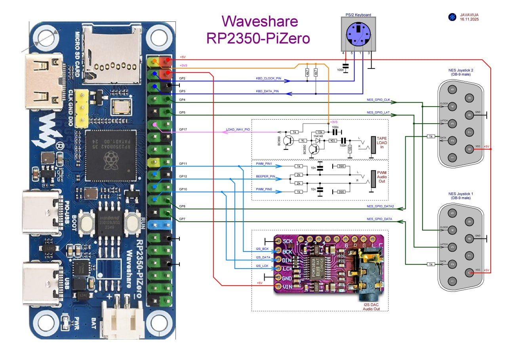
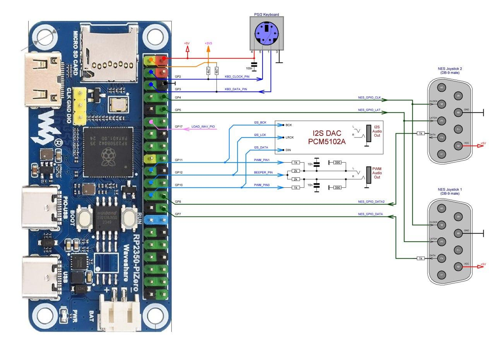
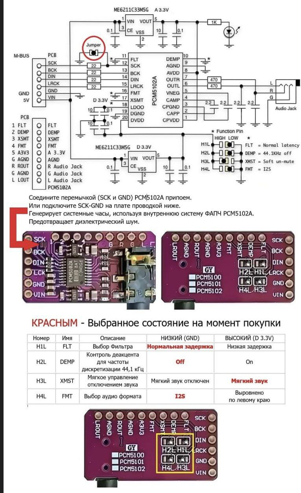

# Workstation setup: Waveshare RP2350-PiZero

[Русская версия](README.md) · English

> This is a translation of the Russian [`README.md`](README.md), made from commit `6253b68`. The Russian text is the reference: if the two differ, the Russian one is newer. [`MANIFEST.md`](MANIFEST.md) and [`../COMPATIBILITY.md`](../COMPATIBILITY.md) are in Russian only.

Status: working instructions, revision 0.11 (2026-10-14). The reference station has been assembled and tested with pico-launcher, MOS2, murm386, PICO-BK, pico-nes, pico-speccy, murmapple (the 252 MHz build is stable, see section 5.3), pico-z26, murmc64 (see section 5.3), frank-micro, frank-msx, atari800 (504 MHz), Game & Watch (252 MHz), pico-gamate, emu80v4 (Korvet, Vector-06C), pico-pce, pico-genesisPlus, pico-gameboy, pico-lynx, pico-mac, pico-watara, pico-wonderswan (504 MHz) and pico-neogeo-pocket (504 MHz). The board code in firmware names and in the compatibility matrix is `z0p2` ([`../COMPATIBILITY.md`](../COMPATIBILITY.md)).

> **This is not the main board of the class.** The main one is the Olimex RP2040-PICO-PC + Pico 2 (class README, §1.7.2). The RP2350-PiZero has no audio output of its own, so every workstation needs **additional equipment** — an external sound module (section 1) wired to the board's pins. This costs more, takes longer to prepare and adds one more place where things can fail. The board makes sense if the Olimex is not available (for example, where delivery from Europe is limited) or if you already have these boards. The class README (§1.7.2) also notes build-quality issues with some units — the boards are checked one by one before they go to the stations (section 5.3).

## 1. Parts for one workstation

| Component | Qty | Note |
|---|---:|---|
| Waveshare RP2350-PiZero | 1 | RP2350B microcontroller, 16 MB flash, microSD slot, mini-HDMI output, two USB Type-C connectors (main USB and PIO-USB), BOOT and RUN buttons. PSRAM is not fitted by default — the board has a footprint for the chip; take the PSRAM variant if possible (class README, §1.7.7) |
| I2S sound module with a PCM5102A DAC | 1 | **Required additional equipment**: sound in the lessons is required (class README, §1.7.4), and the board has no output of its own. I2S was chosen rather than PWM or sound over HDMI: most firmwares of the kit support it, and it does not take processor time from the emulator. Wiring — section 2.1 |
| Female–female Dupont wires | 5 | Dupont Jumper Cable Female to Female — sold in sets, often labelled "for Arduino DIY"; 10–20 cm long. The simplest way to connect the sound module without soldering (section 2.1) |
| HDMI monitor and mini-HDMI → HDMI cable | 1 | 640×480 at 60 Hz must be supported; the BK emulator (PICO-BK) needs 720×576 at 50 Hz (CEA 576p) by default, and selecting boards (section 5.3) also needs 800×600 at 60 Hz. Single-mode cash-register monitors that do not support 640×480 at 60 Hz will not do |
| USB HID keyboard, 101+ keys | 1 | Full-size, with a NumPad. Connected to the USB Type-C connector without the PIO-USB label (unless the firmware name says otherwise) through a USB Type-C (male) → USB-A (female) OTG adapter; details in section 2, item 8 |
| microSD card | 1 | Formatted FAT32 with a 4 KB cluster (section 3); must be checked for SPI-mode compatibility (most often cards of up to 32 GB) |
| Headphones | 1 | Plugged into the sound module's jack; the teacher's and demonstration stations get powered speakers |
| Power | set | A 5 V power supply with a USB Type-C cable — into the second connector, the one labelled PIO-USB: this is the standard way to power the board when the main connector is taken by the keyboard; no hub is needed (section 2, item 9). It is best to check the power supply beforehand to avoid ripple problems |
| Mat under the board | 1 | A mouse pad or a piece of soft material: the board has no case, and the mat protects its contacts and the desk (class README, §1.7.8) |

External PSRAM, a PS/2 keyboard, a USB mouse and NES gamepads are options, not needed for a basic workstation.

## 2. Hardware preparation

1. Inspect the board: the soldering of the mini-HDMI, Type-C and microSD connectors, the pin header, no mechanical damage. Before going to a pupil's station the board passes the selection in section 5.3: the microcontroller is soldered on here, so the whole board is selected.
2. Put the board on a soft mat (a mouse pad): there is no case, and when BOOT and RUN are pressed the pins on the back must not be pressed into the desk (class README, §1.7.8).
3. With the power off, connect the sound module as in section 2.1.
4. Connect the HDMI monitor with the mini-HDMI → HDMI cable. **Turn the volume of the monitor's built-in speakers down to zero** (see the note on sound over HDMI below).
5. Plug the headphones into the sound module's jack. Powered speakers at the teacher's and demonstration stations.
6. Prepare the microSD card as in section 3 and insert it into the board's slot.
7. Install the firmware manager as in section 4.
8. Connect the USB keyboard to the USB Type-C connector without the PIO-USB label (unless the firmware name says otherwise) through a Type-C → USB-A OTG adapter. The adapter has to be checked with the specific board and keyboard.
9. Connect the 5 V power supply to the second Type-C connector — the one labelled PIO-USB. This is the standard way to power the board when the main connector is taken by the keyboard; no hub is needed. Power on for the first time only after all connections are made.

**The PIO-USB connector as a second USB host is an option.** Firmwares with `PIOUSB` in their name (currently one pico-speccy build) can also use USB devices through this connector — for example, a keyboard and a gamepad without a hub. The other firmwares of the kit do not poll it; adding this to them has been postponed.

**Sound over HDMI.** MOS2 outputs sound only to the sound module, but some firmwares (PICO-BK, pico-speccy) also send sound over HDMI. If the monitors' volume is left up, running such a firmware on several stations at once makes a cacophony for the whole class. So the monitor speaker volume is set to zero when the station is prepared, and checked before each lesson; the pupil hears sound only through headphones. Whether a firmware outputs sound over HDMI is shown in [`../COMPATIBILITY.md`](../COMPATIBILITY.md).

### 2.1. Connecting the sound module

The simplest way is **five female–female Dupont wires** (Dupont Jumper Cable Female to Female, "for Arduino DIY"): they slip straight onto the pins of the board's header and the module's pins, no soldering needed. The wiring is as in the diagram below (it is also the `BOARD_Z2` board profile of murm386):

| PCM5102A module pin | Where on the RP2350-PiZero |
|---|---|
| BCK | GP11 |
| DIN | GP10 |
| LCK (LRCK) | GP12 |
| GND | GND |
| VIN | +5V |
| SCK | to GND **on the module itself** — a solder bridge between the SCK and GND pads (circled in red in the diagram below); if soldering is not possible, a sixth wire to GND |

The diagram shows everything that can be connected to the board; a class workstation needs only the I2S module at the bottom (I2S DAC Audio Out). Sound through I2S and through PWM (the PWM Audio Out block) are alternatives: they use the same pins GP10–GP12, and only one is connected at a time. A PS/2 keyboard, NES gamepads and the tape input are optional.

The same wiring drawn differently, with the I2S module as a block:

**Setting up the PCM5102A module.** On the back of the module there are the jumpers H1L–H4L; from the factory they are usually already set as needed (FLT — normal latency, DEMP — off, XSMT — sound on, FMT — I2S). If not, you will have to take a soldering iron and fix them. Check them against the picture and solder the SCK–GND bridge:

The same pins GP10 (DIN), GP11 (BCK), GP12 (LRCK) are used by all firmwares of the kit for the z0p2 that output sound through I2S: MOS2, murm386, PICO-BK, pico-nes, pico-speccy, murmapple, pico-z26, murmc64, frank-micro, frank-msx, atari800, Game & Watch, pico-gamate, emu80v4 (Korvet, Vector-06C), pico-pce, pico-genesisPlus, pico-gameboy, pico-lynx, pico-mac, pico-watara, pico-wonderswan and pico-neogeo-pocket. The module is connected once and is not rewired when the firmware changes.

It is best to choose a module with the header already soldered on, but often the header comes loose in the package or is sold separately. In that case too you will have to take a soldering iron and finish the job.

## 3. Preparing the SD card

1. Save any data you need from the card: formatting erases the existing content.
2. Create a partition with the **FAT32 file system and a 4 KB cluster size** (4096 bytes). With a different cluster size, FreeDOS (which murm386 boots) may have problems. Factory formatting and the SD Card Formatter program usually set a 32 KB cluster for 16–32 GB cards, so format the card yourself:
   - Windows: `format X: /FS:FAT32 /A:4096 /Q` (X is the card's drive letter), or in the "Format" window choose FAT32 and an "Allocation unit size" of 4096 bytes;
   - Linux: `sudo mkfs.vfat -F 32 -s 8 -S 512 /dev/sdX1`;
   - macOS: `sudo newfs_msdos -F 32 -c 8 /dev/diskXs1` (after `diskutil unmountDisk`).
3. Copy the files to the card in two steps — the order matters:
   1. the **contents** of the common [`sdcard/`](../../sdcard/) folder from the root of the repository — to the root of the card. This is the part common to all boards: `/mos2` (MOS2 with applications and `config.sys`), `/freedos` with games and learning programs for murm386, `/ZX` with programs and games for pico-speccy, `/test` with files for workstation acceptance (section 5) and folders for the other emulators. The content is described in [`../../SDCARD.en.md`](../../SDCARD.en.md);
   2. then the **contents** of this board's [`sdcard/`](sdcard/) folder (`hardware/waveshare-rp2350-pizero/sdcard`) — on top, to the root of the same card. It holds the emulators built for the `z0p2` (`/emu`); where names match, the board's files replace the common ones. The content is listed in [`MANIFEST.md`](MANIFEST.md).
4. Add only firmwares built specifically for the **z0p2**. Builds for other boards (for example, with the `PCp2-` prefix) do not work here: they have different video, SD-card and sound pins. MOS2 recognises its board's firmwares by the `.z0p2` extension (case-sensitive); both managers also start ordinary `.uf2` files. It is recommended to name the kit's firmwares with the `z0p2-` prefix, as in the `sdcard/emu` folder, so that the name shows which board they were built for.
5. Put learning programs, data and games into separate folders. The content of the kit and the test status of the firmwares are in [`../COMPATIBILITY.md`](../COMPATIBILITY.md).
6. Before making copies, the integrity of the reference set is checked against two files: [`SHA256SUMS`](../../SHA256SUMS) in the root of the repository — the common part (see `SDCARD.en.md`, section 23), and [`SHA256SUMS`](SHA256SUMS) in the board folder — the UF2 files and the board's files (see `MANIFEST.md`, section 3).

The same card can serve boards of different types if it holds emulators for each: the files differ by prefix, and murm386 keeps its settings for each board separately (for this one, in `/.config/386/Z2/`).

## 4. Installing the firmware manager

One of two managers is installed on the board:

- **pico-launcher — the main option** for the beginner level: [`pico-launcher/z0p2-uf2-launcher-HDMI-HID.uf2`](pico-launcher/). A file browser for the SD card with help (F1), a viewer (F3) and a simple editor (F4) for text files; it starts the firmwares of the kit. Acceptance — section 5.1.
- **MOS2 (murmulator-os2) — the advanced option** for lessons with a command line, a file system and BASIC: [`murmulator-os2/z0p2-murmulator-os-VGA-HDMI-HID-2.3.3-252MHz-1.uf2`](murmulator-os2/). It boots and works.

The TCC C compiler that comes with MOS2 is described in [`../../SDCARD.en.md`](../../SDCARD.en.md), section 2.

The versions, sources and checksums are in [`MANIFEST.md`](MANIFEST.md).

The first installation is done through the standard RP2350 boot loader (BOOTSEL mode). The buttons on the board are called **BOOT** and **RUN**:

1. With USB disconnected, hold the **BOOT** button.
2. Connect the board to a computer with a USB Type-C cable through the connector **without** the PIO-USB label.
3. Release BOOT once the boot loader's USB drive appears.
4. Copy the manager's UF2 file to the drive.

There is no need to reconnect to enter the boot loader: while holding BOOT, briefly press RUN, then release BOOT.

In pico-launcher and MOS2, holding **F11** at power-on or reboot prevents the previously chosen firmware from starting automatically and opens the file manager, where you can choose the target firmware — for example, a game or an emulator.

**If something does not load** (black screen, the wrong firmware starts straight away, the manager "goes dark" with the SD card inserted), do this:

1. Power on or reboot the board while holding **F11**.
2. If it still does not load with F11, take out the SD card, delete the file `/.firmware` from it on a computer and put the card back. This marker file is left on the card after a firmware is started from the manager and makes the board go back into that firmware; deleting it does no harm — the manager creates it again the next time a firmware is chosen.

The usual way to reboot is **Ctrl+Alt+Del**: pico-launcher, MOS2 and almost all firmwares of the kit support it (firmwares that cannot do it, or do something else, are usually marked in the corresponding teaching module). The RUN button and unplugging the power are needed only if a firmware has hung and does not react to the keyboard or to **Ctrl+Alt+Del**.

## 5. Workstation acceptance

Acceptance is done for the manager installed on the station: 5.1 — pico-launcher (the main option), 5.2 — MOS2. Common preconditions: the card is prepared as in section 3, the manager is installed as in section 4, and the headphones are not on tightly while the sound is checked — first make sure the volume is moderate.

If there is no sound or it drops out, first rule out the headphones: listen to them on another source (a phone), wiggle the plug and the volume control on the cord. Then check the module's five wires and the SCK–GND bridge (section 2.1) — a wire that has slipped off its pin is more common than a firmware bug. If the manager does not load, follow the order in section 4 ("If something does not load").

### 5.1. Workstation with pico-launcher

| # | Check | Actions | Expected result |
|---:|---|---|---|
| 1 | Boot | Power on; if a firmware was chosen before, hold **F11** | The SD-card file browser, the `/mos2` and `/test` folders are visible, no SD error message |
| 2 | Video | Look at the screen | The picture is stable, without dropouts or flicker, text is not cut off at the edges |
| 3 | Navigation | Arrows, PgUp/PgDn, Home/End; Enter on the `/test` folder | The selection moves; the folder opens |
| 4 | Help | **F1**, then Esc | The help window opens and closes |
| 5 | Viewer | On `/test/edit.txt` — **F3**, arrows, then **F10** | The file text is visible and scrolls; F10 returns to the browser |
| 6 | Editor, keyboard and writing to SD | On `/test/edit.txt` — **F4**; type letters, digits, digits on the NumPad (with NumLock), Enter, Backspace; Ins; **F2**; Esc; then F3 again | All typed characters appear; Ins toggles INS/OVR; after F2 and exiting, the viewer shows the saved changes |
| 7 | Delete with cancel | On `/test/edit.txt` — **F8**, then Esc | A confirmation prompt appears; after Esc the file is still there |
| 8 | Starting a firmware | Enter on a firmware in `/emu` (for example, `z0p2-bk-…`); then **Ctrl+Alt+Del** while holding **F11** | The firmware starts and reboots on Ctrl+Alt+Del; with F11 — the browser again |
| 9 | Sound | Start any firmware accepted on this board (status ✅ in `COMPATIBILITY.md`), for example murm386 (`/emu/z0p2-386-RUNTIME-…`), PICO-BK (`/emu/z0p2-bk-…`) or pico-speccy (`/emu/z0p2-speccy-…`) | Sound in the headphones plugged into the sound module. The launcher itself outputs no sound |

The launcher does not use F5–F7, F9 and F12. F5–F7 are checked in `mc` during MOS2 acceptance (5.2), the others in the firmwares that use them.

### 5.2. Workstation with MOS2

Commands are typed in the MOS2 console: in `mc` the console is shown and hidden with **Ctrl+O**.

| # | Check | Actions | Expected result |
|---:|---|---|---|
| 1 | Boot | Power on | After a few seconds the monitor shows `mc` (Murmulator Commander), no SD error messages |
| 2 | CPU and memory | `cpu`, then `mem` | Clock 252 MHz; memory information is shown without errors |
| 3 | Video | `mode 0`, `mode 1`, `mode 2`, then `gmode 2`, then `mode 0` | In each mode the picture is stable, without dropouts or flicker, and the monitor does not say "no signal". `gmode 2` shows a colour test chart and reports the driver's graphics resolution — write it down. Return with `mode 0`: on HDMI in `mode 1` the font is displayed with errors (a known MOS2 shortcoming; it does not fail the acceptance) |
| 4 | Keyboard | `basic /test/kbdtest.bas`, press keys one at a time; exit with Ctrl+C | Letters and digits print their code and character; Enter, Esc and the NumPad (with NumLock on) print their code. Ctrl+Shift switches the layout. BASIC does not receive the F keys — they are checked in item 4a |
| 4a | F keys | In `mc` on the file `/test/edit.txt`: **F1**, **F3**, **F4** — close each window with Esc; **F5**, **F6**, **F7**, **F8** — cancel each prompt with Esc | Each key opens its window or prompt; after cancelling, files and folders are unchanged. F2, F9, F11, F12 are not used in `mc`; F11 is checked in item 8 |
| 5 | SD: reading and writing | `ls /`, `cp /mos2/config.sys /tmp/t.txt`, `type /tmp/t.txt`, `rm /tmp/t.txt` | The `/mos2` and `/test` folders are visible; the copy is created, the content of `config.sys` is printed, the file is deleted |
| 6 | Sound, mono | `wav /test/snd_mono.wav` | The file parameters are shown (8000 Hz, 1 channel); three tones rising in pitch, in both ears, without crackling. If MOS2 does not respond after playback, reset the board |
| 7 | Sound, channels | `wav /test/snd_lr.wav` | The low tone only on the left, the middle one only on the right, the high one in both. If the channels are swapped, note it in `COMPATIBILITY.md` |
| 7a | Sound, clicks | On an empty command line press **Esc** or **Backspace** | Short clicks in the headphones (the `blimp` command) |
| 8 | Switching firmwares | In `mc` choose a firmware from `/emu`, Enter; then **Ctrl+Alt+Del** while holding **F11** | The firmware starts and reboots on Ctrl+Alt+Del; with F11 — MOS2 again |
| 9 | Reboot | Ctrl+Alt+Del | MOS2 boots again, as in item 1 |

### 5.3. Selecting boards for overclocking

Most emulators of the kit run the RP2350 core overclocked and at a raised voltage (see the "Частота / напряжение" (clock / voltage) column in [`../COMPATIBILITY.md`](../COMPATIBILITY.md)). RP2350 chips differ in how far they can be overclocked, so every board is checked before it goes to a workstation. The RP2350B microcontroller is soldered on, so **the whole board** is selected. The check is done on an assembled workstation with the SD card from section 3.

**The selection threshold** is set by the most demanding firmware of the kit — the maximum values in the clock / voltage column of the compatibility matrix. Currently this is murm386: 504 MHz / 1.6 V. The threshold may rise as firmwares are added; then the last stage of the check is run at the new values, and the boards selected earlier are checked again.

**Stage length.** As a guide, at least 10 minutes of work without failures. A batch is conveniently checked in a round: start the stage on all stations one after another and come back to the first — if the board has not hung or shown artefacts in that time, the stage is passed.

| # | Firmware | Mode | Actions | Criterion |
|---:|---|---|---|---|
| 1 | PICO-BK | 720×576, 270 MHz / 1.3 V | Start `/emu/z0p2-bk-…uf2` | Stable picture, sound in the headphones |
| 2 | PICO-BK | 800×600, 400 MHz / 1.5 V | Home → HDMI item → space; start a game from the built-in floppy (Tab, arrows, Enter) and leave it running | No hangs, resets, picture or sound artefacts |
| 3 | murm386 | the selection threshold, currently 504 MHz / 1.6 V (Win+F11 menu) | Start `/emu/z0p2-386-RUNTIME-…uf2`*, wait for Volkov Commander; start `\FREEDOS\SI.EXE`; leave it running | FreeDOS boots, SI shows the performance index, the system does not hang |

\* if PSRAM is fitted on the board, it makes sense to choose the firmwares from the `/emu/psram` folder: they are adapted to PSRAM and faster than the universal build. Of the 286/386 emulators, the 286 variant gives the best performance — its emulator is "lighter".

On the reference board the 400 MHz (PICO-BK) and 504 MHz / 1.6 V (murm386) modes were tested. The PICO-BK 1024×768 / 512 MHz mode was not tested on this board and is not part of the selection — item 3 checks a clock above the threshold. After the check, set PICO-BK back to the 720×576 video mode (Home → HDMI), so that the card and the board are in their original state.

**murmapple (Apple IIe)** is in `/emu` in three builds for different clocks. The stable variant is `z0p2-frank_apple-HDMI-252MHz-…`: on the reference board the picture is clean, and sound and disk loading work; this is the one installed on the pupils' stations. With the 378 MHz build the reference board showed faint interference (short light streaks) and rare sync dropouts, and with 504 MHz occasional reboots. Whether to use the 378 and 504 MHz builds, and whether to test them on your own hardware, is up to the teacher; they are not part of the selection threshold or the table below.

**murmc64 (Commodore 64)** is in `/emu` in four builds: 252 MHz, 378 MHz with HDMI at 90 Hz (`…-90Hz-378MHz-…`), 378 MHz with HDMI at 60 Hz and 504 MHz. On the reference board all work stably except the 378 MHz build with HDMI at 60 Hz: it showed interference and sync dropouts. The variant is chosen for the specific board from the three stable ones; the 90 Hz build needs a monitor that accepts 640×480 at 90 Hz. Whether to test the 378 MHz / 60 Hz build on your own hardware is up to the teacher. These builds are not part of the selection threshold.

A board is classed by the highest mode it passed:

| Class | Passed | Suitable for |
|---|---|---|
| A | items 1–3 at the selection threshold | all firmwares of the kit |
| B | items 1–2 | firmwares up to 400 MHz / 1.5 V: pico-launcher, MOS2, PICO-BK, pico-nes, pico-speccy, murmapple, pico-z26, murmc64 (252 MHz builds), frank-micro, frank-msx, Game & Watch, pico-pce, pico-genesisPlus, pico-gameboy, pico-lynx (252 MHz), Korvet, Vector-06C and pico-mac (400 MHz); pico-gamate and pico-watara (378 MHz / 1.6 V) — check separately |
| C | item 1 | pico-launcher, MOS2 and firmwares up to 270 MHz |

Class A boards go to the pupils' stations. Class B and C boards are labelled and used as spares for light tasks or at the teacher's station.

Overclocking and voltages above nominal are outside the modes guaranteed by the manufacturer and may reduce the chip's stability over time. Items 2–3 are repeated once a school term and whenever unexplained hangs appear on a workstation.

The acceptance result is recorded in [`../COMPATIBILITY.md`](../COMPATIBILITY.md): date, board unit, items passed, remarks, the board's class according to section 5.3.

## 6. Rolling out to the whole class

After the reference station has passed acceptance, record the versions of the manager and the firmwares, the content of the SD card, the settings and the test results. Make copies of the reference SD card for the other stations; check booting and sound on each unit. Do not take a check of one sample as proof that the whole batch of equipment works.

The spare part on this board is **the whole board** with the manager already installed: if the pico-launcher or MOS2 firmware is damaged, it is faster to swap the board during the lesson than to reflash it, and deal with the repair at a calmer time. Keep spare sound modules, Dupont wires and OTG adapters too: on a workstation without a case these are the most common points of failure.

Be prepared for children to mess up the data on the SD card: it is best to have spare cards prepared in advance for quick replacement without holding up the lesson.

## Files in this folder

| Path | What is here |
|---|---|
| [`MANIFEST.md`](MANIFEST.md) | what is in the board folder, what sources it was built from, checksums (in Russian) |
| [`SHA256SUMS`](SHA256SUMS) | checksums of the board's files (how to check — [`MANIFEST.md`](MANIFEST.md), section 3) |
| [`pico-launcher/`](pico-launcher/) | pico-launcher build for the `z0p2` |
| [`murmulator-os2/`](murmulator-os2/) | MOS2 build for the `z0p2` |
| [`sdcard/emu/`](sdcard/emu/) | emulators built for the `z0p2`: murm386 (three builds), PICO-BK, pico-nes, pico-speccy (two builds), murmapple (three builds for 252, 378 and 504 MHz), pico-z26, murmc64 (four builds), frank-micro, frank-msx, atari800, Game & Watch, pico-gamate, emu80v4 (Korvet and Vector-06C), pico-pce, pico-genesisPlus, pico-gameboy, pico-lynx, pico-mac, pico-watara, pico-wonderswan, pico-neogeo-pocket |
| [`img/`](img/) | connection diagrams from the MOS2 repository (section 2.1) |

## Sources

- [Waveshare RP2350-PiZero: board description](https://www.waveshare.com/wiki/RP2350-PiZero)
- [CNX Software: RP2350-PiZero review](https://www.cnx-software.com/?p=153554) — USB connectors, BOOT and RUN buttons, PSRAM footprint
- [murm386: the `BOARD_Z2` board profile](https://github.com/DnCraptor/murm386/blob/main/src/board_config.h)
- [murmulator-os2: connection diagrams (PCM510x, PWM, PS/2, NES)](https://github.com/DnCraptor/murmulator-os2) — the pictures in `img/` were copied from there unchanged (`assets/z0p2-pinout.jpg`, `assets/z0p2-pinout2.jpg`, `assets/i2s-dac.jpg`, commit `aad5813`); the project is GPL v3, the connection diagrams are by JAVAVIUA
